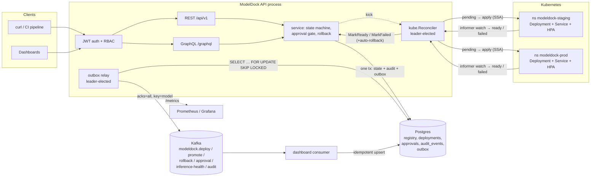
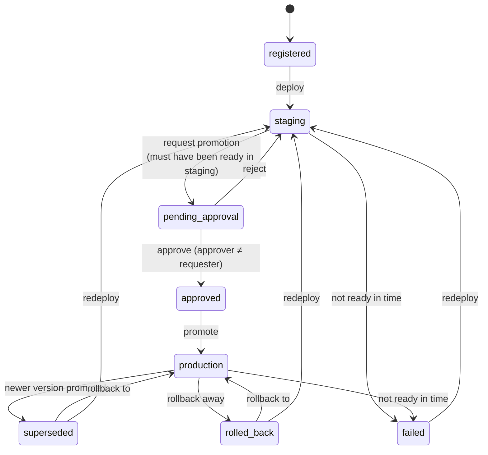

# ModelDock

A model deployment control plane for Kubernetes, written in Go 1.22. You
register model-server images as versions, deploy them to **staging**, get an
**approval** from a different person, **promote** to **prod**, and **roll back**
in one call. Every state change is written to an append-only audit log in
Postgres and published to Kafka through a transactional outbox.

> **Verification status, read first.** Everything below is tested, but not
> everything ran on a real cluster. See [Verification status](#verification-status)
> for exactly what ran where. In short: Postgres, Kafka, the API, the outbox
> under `SIGKILL`, and the Docker images ran for real. The Kubernetes client ran
> against a **real k3s API server whose node could not start containers** (a
> sandbox limitation). Pods actually becoming ready is covered by
> `scripts/kind-e2e.sh` and the `kind-e2e` CI job, which had not run when this
> README was written.

## Architecture



Request path: an API call never touches Kubernetes. It commits a `pending`
deployment row and its audit event in one transaction, then wakes the
reconciler. The reconciler applies the workload, watches it through an
informer, and records `ready` or `failed` (in another single transaction with
its event). If the process dies between those steps, the next leader picks up
the `pending` or `progressing` rows and carries on.

### Version lifecycle (state machine)



The transition table in [`domain/statemachine.go`](domain/statemachine.go) is
the single source of truth. Tests check that only `approved → promote` and
`superseded|rolled_back → rollback` can reach `production`, so neither a
rollback nor a direct deploy can get around the approval gate.

## Repository layout

| Path | What |
|---|---|
| `domain/` | Entities, version state machine, diff, validation (pure, no I/O) |
| `auth/` | JWT (HS256) verification, role claims, RBAC policy, four-eyes rule, middleware |
| `service/` | Use cases: register, deploy, request/approve/reject, promote, rollback, reconciler callbacks |
| `store/` | Postgres via pgx, embedded golang-migrate migrations, outbox claim, audit log, dashboard read model |
| `events/` | Event envelope and topics, outbox relay, Kafka publisher, dashboard consumer |
| `kube/` | `Client` interface, manifest builder, **`Fake`** (tests) and **`ClientGo`** (real) implementations, reconciler |
| `api/` | REST (Go 1.22 `ServeMux` patterns) and GraphQL (gqlgen, `api/graph`), HTTP metrics |
| `cmd/modeldock/` | `serve`, `consume`, `migrate`, `token`, `render` |
| `model-server/` | Sample FastAPI + scikit-learn Iris server: `/health`, `/predict`, `/metrics` |
| `deploy/` | Dockerfile, docker-compose (Postgres, Kafka KRaft, API, consumer), Helm chart |
| `observability/` | Grafana dashboard JSON, Prometheus scrape config and alert rules |
| `loadtest/`, `docs/results.md` | vegeta script and the measured results |
| `scripts/` | `demo.sh` (curl + GraphQL walkthrough), `kind-e2e.sh` (real-cluster test) |

## Quick start

```sh
make setup          # Go modules, staticcheck, kubeconform, model-server venv
make test           # starts Postgres + Kafka via compose, runs every Go test
make compose-up     # Postgres, Kafka, API (:8080, fake kube), dashboard consumer
make demo           # walkthrough below, against the running stack
```

`make help` lists all targets: `lint`, `manifests`, `model-server-test`,
`loadtest`, `kind-e2e`, `images`, and so on.

To deploy model servers for real, run the API with `-kube real` and a
kubeconfig (`modeldock serve -kube real -kubeconfig ~/.kube/config`), or install
the Helm chart, which uses in-cluster config and a least-privilege service account.

## API examples

Tokens: `modeldock token -sub dana -role deployer` mints a dev JWT signed with
`MODELDOCK_JWT_SECRET`. Roles are `viewer`, `deployer`, `approver`, `admin`.

```sh
API=http://localhost:8080
DEP=$(go run ./cmd/modeldock token -sub dana  -role deployer)
APR=$(go run ./cmd/modeldock token -sub alice -role approver)
h() { echo "Authorization: Bearer $1"; }

# Register a model and a version (image + metadata + resource requests)
curl -s -XPOST $API/api/v1/models -H "$(h $DEP)" -d '{"name":"iris","description":"Iris classifier"}'
curl -s -XPOST $API/api/v1/models/iris/versions -H "$(h $DEP)" -d '{
  "version":"1.0.0", "image":"modeldock/iris-server:1.0.0",
  "metadata":{"framework":"sklearn","accuracy":"0.93"},
  "resources":{"cpuRequest":"100m","memoryRequest":"128Mi","memoryLimit":"256Mi"},
  "scaling":{"minReplicas":2,"maxReplicas":6,"targetCPUPercentage":70}}'

# Deploy to staging (Deployment + Service + HPA in modeldock-staging) -> 202, status "pending"
curl -s -XPOST $API/api/v1/models/iris/versions/1.0.0/deploy -H "$(h $DEP)" -d '{"environment":"staging"}'
curl -s $API/api/v1/deployments/<id> -H "$(h $DEP)"           # pending -> progressing -> ready

# Promotion: request (deployer), approve (a different approver), promote (deployer)
curl -s -XPOST $API/api/v1/models/iris/versions/1.0.0/promotion-requests -H "$(h $DEP)" -d '{"comment":"staging green"}'
curl -s -XPOST $API/api/v1/approvals/<approval-id>/approve -H "$(h $DEP)"   # 403: deployers cannot approve
curl -s -XPOST $API/api/v1/approvals/<approval-id>/approve -H "$(h $APR)" -d '{"comment":"lgtm"}'
curl -s -XPOST $API/api/v1/models/iris/versions/1.0.0/promote -H "$(h $DEP)"

# Rollback in one call: to the previous known-good version, or to a named one
curl -s -XPOST $API/api/v1/models/iris/rollback -H "$(h $DEP)" -d '{"environment":"prod"}'
curl -s -XPOST $API/api/v1/models/iris/rollback -H "$(h $DEP)" -d '{"environment":"prod","toVersion":"1.0.0"}'

# Status, history, diff, audit, dashboard
curl -s $API/api/v1/models/iris/status -H "$(h $DEP)"
curl -s "$API/api/v1/models/iris/deployments?environment=prod" -H "$(h $DEP)"
curl -s "$API/api/v1/models/iris/diff?from=1.0.0&to=1.1.0" -H "$(h $DEP)"
curl -s "$API/api/v1/audit?model=iris&limit=20" -H "$(h $DEP)"
curl -s $API/api/v1/dashboard -H "$(h $DEP)"
```

Errors are JSON `{"error": "...", "code": N}`: 400 invalid input, 401 no or
invalid token, 403 role or four-eyes violation, 404 not found, 409 illegal
state transition or race lost.

### GraphQL

`POST /graphql` (playground at `/playground` when enabled). One request can
fetch everything a dashboard needs:

```graphql
{
  model(name: "iris") {
    versions(limit: 10) { version state image metadata { key value } }
    staging { version status revision }
    prod    { version status revision kind readyAt }
    deployments(environment: "prod", limit: 5) { revision version kind status reason }
  }
  diff(model: "iris", from: "1.0.0", to: "1.1.0") { changes { field from to } }
  approvals(status: "pending") { id modelName version requestedBy }
  dashboard { model lastDeployVersion lastDeployStatus failureRate }
}
```

```graphql
mutation { approve(approvalId: "…", comment: "lgtm") { status decidedBy } }
mutation { rollback(model: "iris", environment: "prod") { revision version kind } }
```

Errors carry `extensions.code`: `UNAUTHENTICATED`, `FORBIDDEN`, `NOT_FOUND`,
`CONFLICT`, `BAD_USER_INPUT`, or `INTERNAL`.

## RBAC

| | viewer | deployer | approver | admin |
|---|:-:|:-:|:-:|:-:|
| read (models, history, audit, dashboard) | ✓ | ✓ | ✓ | ✓ |
| register models/versions | | ✓ | | ✓ |
| deploy staging, request promotion, promote approved, rollback | | ✓ | | ✓ |
| approve / reject promotions | | | ✓ | ✓ |

The roles are intentionally **not a hierarchy**: approvers cannot deploy and
deployers cannot approve. In addition, **nobody can approve a request they
made**, admins included. This is enforced in `auth.CanDecide` and again by a
Postgres `CHECK (decided_by <> requested_by)` constraint.

## Design decisions

**Why the outbox pattern.** A deployment record and its audit event must
never diverge. A plain "commit, then publish" approach loses the event if the
process dies in between; "publish, then commit" announces changes that may
then roll back. With the outbox, the event row is written in the same
transaction as the state change (`Tx.AppendEvent`), and a relay publishes
committed rows afterwards. `events/outbox_crash_test.go` `SIGKILL`s a child
process at three points (mid-transaction, after commit before publish, and
after broker ack before the row is marked published) and checks that no event
is lost and that no event exists without its state. Delivery is at least once;
the dashboard consumer dedupes by event ID in the same transaction as its
projection, so its effects are exactly once.

**Why an approval gate, and why in the state machine.** Production changes
need a second pair of eyes, and an auditor needs to see who approved what. The
gate is a state (`approved`), not a flag that handlers check, so every path to
`production` (promote, rollback, auto-rollback) goes through the transition
table, and tests enumerate that table. Rollback skips re-approval only for
versions that were already live in prod. That keeps "rollback in one call"
fast during an incident without opening a bypass.

**Why both REST and GraphQL.** REST suits automation: CI pipelines and
`curl`, cacheable GETs, and clear status codes. GraphQL suits dashboards that
want a model, its versions, per-environment status, and recent history in one
round trip. Both are thin adapters over the same `service` methods, so
authorization and state rules cannot drift between them. The cost is two
surfaces to document, and GraphQL needs query cost limits
(`FixedComplexityLimit(500)`, bounded list arguments). The load test found an
unbounded `versions` list, now fixed.

**Why the API never calls Kubernetes.** The database holds the desired state
and the reconciler converges the cluster toward it. Requests stay fast and
independent of API-server latency, a crash cannot leave a half-applied
deployment untracked, and re-applying is idempotent (server-side apply, field
manager `modeldock`).

**Other trade-offs**
- *Polling + `SKIP LOCKED` vs. CDC (Debezium) or `LISTEN/NOTIFY`.* Polling is
  simple and has no extra infrastructure; it costs about 130 ms p50 of
  commit-to-Kafka lag at a 500 ms interval (measured).
- *Single leader via Postgres advisory locks* for the relay and reconciler.
  This keeps per-model event order, and API replicas scale horizontally. The
  leader's locks use their own connections, outside the request pool (a bug
  the load test found).
- *One Kubernetes Deployment per model per environment*, updated with
  rolling updates (`maxUnavailable: 0`). This is not canary or blue-green.
- *Identity is delegated*: ModelDock stores the JWT subject on every action
  but keeps no users table. HS256 is used for simplicity; production would use
  RS256/JWKS from an IdP (only the key function changes).
- *Text + CHECK columns instead of Postgres enums*, so adding a state is a
  cheap, transactional migration.

## Observability

- `/metrics` exposes:
  - `modeldock_http_request_duration_seconds{route,method,code}`
  - `modeldock_deploy_duration_seconds{environment,kind,outcome}`
  - `modeldock_promotions_total`
  - `modeldock_rollbacks_total{trigger}`
  - `modeldock_approval_decisions_total`
  - the outbox metrics: backlog, oldest age, published, errors
  - `modeldock_inference_health_changes_total`
- Model servers expose `model_predictions_total`, `model_prediction_latency_seconds`
  and `model_info`. ModelDock adds `prometheus.io/*` pod annotations.
- [`observability/grafana/modeldock-dashboard.json`](observability/grafana/modeldock-dashboard.json)
  has 20 panels. Every query was evaluated against a live Prometheus scraping
  the compose stack. The model-server panels had no data there, because no
  real pods ran.
- [`observability/prometheus/alerts.yml`](observability/prometheus/alerts.yml)
  holds alerts for a stalled outbox, rollout failures, and API 5xx (checked
  with `promtool`).

## Load test

Measured with vegeta on a single 4-vCPU VM (load generator, API, Postgres,
and Kafka all on one host; fake kube). Full details and caveats are in
[`docs/results.md`](docs/results.md).

| Scenario | Rate | p50 | p99 |
|---|---:|---:|---:|
| REST status | 300/s | 1.90 ms | 5.08 ms |
| REST history | 300/s | 1.82 ms | 5.38 ms |
| GraphQL composite query | 300/s | 2.63 ms | 17.1 ms |
| Register version (tx + audit + outbox) | 100/s | 3.88 ms | 10.6 ms |

The first run showed GraphQL p50 at **599 ms**. That run exposed the pool
exhaustion and unbounded-list bugs described in `docs/results.md`; both are fixed.

## Verification status

**Verified in the development sandbox**

| What | How |
|---|---|
| State machine, RBAC matrix, four-eyes rule, JWT validation (expired, wrong alg/key/iss/aud, `none`), middleware | unit tests |
| Store against **real Postgres 16**: migrations, revision numbering, CAS updates, append-only audit trigger (UPDATE/DELETE/TRUNCATE rejected), self-approval DB constraint, leader lock | `store/` tests |
| Full lifecycle, auto-rollback, rollback guards, concurrent approvers (exactly 1 wins), concurrent deploys (distinct revisions) | `service/` tests (real Postgres + fake kube) |
| Outbox crash consistency with real `SIGKILL` at 3 points | `events/outbox_crash_test.go` |
| Relay → **real Kafka 3.8** → consumer → dashboard; per-model ordering; dedup of forced redelivery | `TestKafkaEndToEnd` |
| REST + GraphQL over HTTP with real JWTs, error mapping, metrics exposure | `api/` tests |
| `go test -race ./...`, `go vet`, staticcheck, golangci-lint: clean | local |
| Builds on **Go 1.22** (image built with the `golang:1.22` builder) | `deploy/Dockerfile` |
| docker-compose stack (Postgres, Kafka, API, consumer) running `scripts/demo.sh` end to end | local |
| Model-server image: trains at build, runs read-only / non-root / no caps, `/predict` correct | `docker run` + pytest |
| Rendered manifests and Helm chart pass `kubeconform -strict` (k8s 1.30) and **server-side dry-run** on k3s 1.31 | `make manifests` |
| `kube.ClientGo` against a **real k3s v1.31 API server**: SSA of Deployment/Service/HPA, idempotent re-apply, informer-observed status, revision tracking | `TestClientGoAgainstRealCluster` |
| `modeldock serve -kube real` on k3s as the **chart's least-privilege service account**; the reconciler failed a never-ready rollout at the deadline ("not ready within 45s (updated=1 available=0 desired=1)") | manual run |
| Helm install on k3s; `kubectl auth can-i` confirms the SA can manage workloads only in the target namespaces (no pods, secrets, or other namespaces) | manual run |

**Not verified**

- **Pods actually becoming ready on Kubernetes.** The sandbox VM rejects
  negative `oom_score_adj`, which kubelet requires for pod sandboxes, so
  `kind` (nested) and k3s could run the control plane but no pods.
  `scripts/kind-e2e.sh` and the CI `kind-e2e` job cover this: pods running,
  `/predict` serving the rolled-back version, and an unpullable image failing
  and auto-rolling back. **This had not run when this README was written.**
- HPA scaling behaviour (needs metrics-server), PodDisruptionBudget, and the
  ServiceMonitor (needs the Prometheus Operator).
- Helm-deployed ModelDock pods running in-cluster (images were not pushed
  anywhere).
- Multi-replica API leader failover under load (the lock itself is tested).
- Multi-broker Kafka and real `acks=all` replication.

### Verify on a real cluster

```sh
# kind (local): creates the cluster, loads the model image, runs Postgres+Kafka
# in compose and ModelDock on the host with -kube real, then checks pods,
# /predict after rollback, and failure + auto-rollback.
make kind-e2e

# or step by step against any cluster in your kubeconfig:
make deps-up build
docker build -t modeldock/iris-server:1.0.0 model-server            # push to your registry if not kind
MODELDOCK_TEST_KUBECONFIG=$HOME/.kube/config MODELDOCK_TEST_EXPECT_READY=1 \
  MODELDOCK_TEST_IMAGE=<registry>/iris-server:1.0.0 go test -run RealCluster -v ./kube/
./bin/modeldock serve -kube real -events kafka -kafka-brokers localhost:29092 -auto-rollback \
  -database-url "$MODELDOCK_TEST_DATABASE_URL" &
WAIT_SECS=180 ./scripts/demo.sh            # change the image refs in demo.sh to your registry
kubectl -n modeldock-prod get deploy,svc,hpa,pods
```

## Limitations

- One rollout strategy (rolling update). No canary, traffic splitting, or
  shadow deployments.
- Model servers must expose `/health` on a named `http` port. Probes are not
  configurable per version.
- Readiness means "pods available". It does not check model quality.
  Inference-health events come from replica availability, not from probing
  `/predict` or reading error-rate metrics.
- Outbox polling adds up to one interval (500 ms) of lag. Kafka downtime
  grows the backlog (alerted on) but never blocks the API.
- The dashboard read model is eventually consistent and depends on Kafka.
- HS256 shared-secret JWTs; no token revocation. There is no UI.
- Rollback to a version that has since been redeployed to staging is refused
  (its state is `staging`, not `superseded`/`rolled_back`). Promote it again instead.
- The `environments` table is seeded with staging/prod; there is no API to add more.
