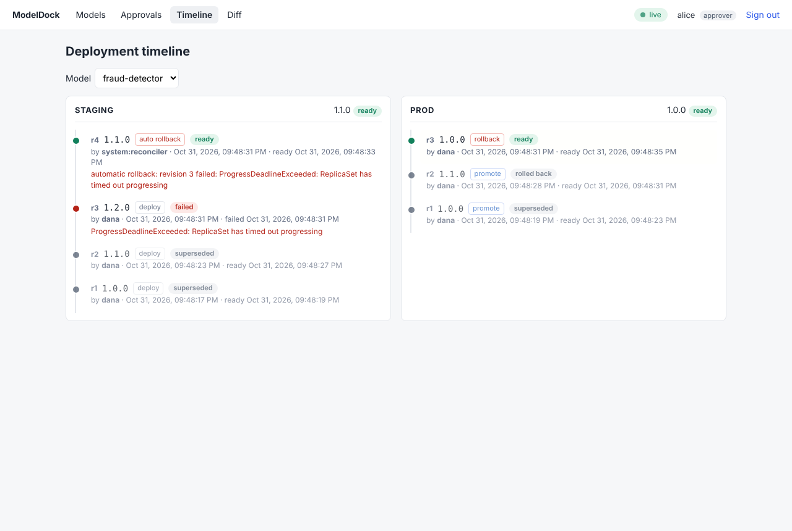
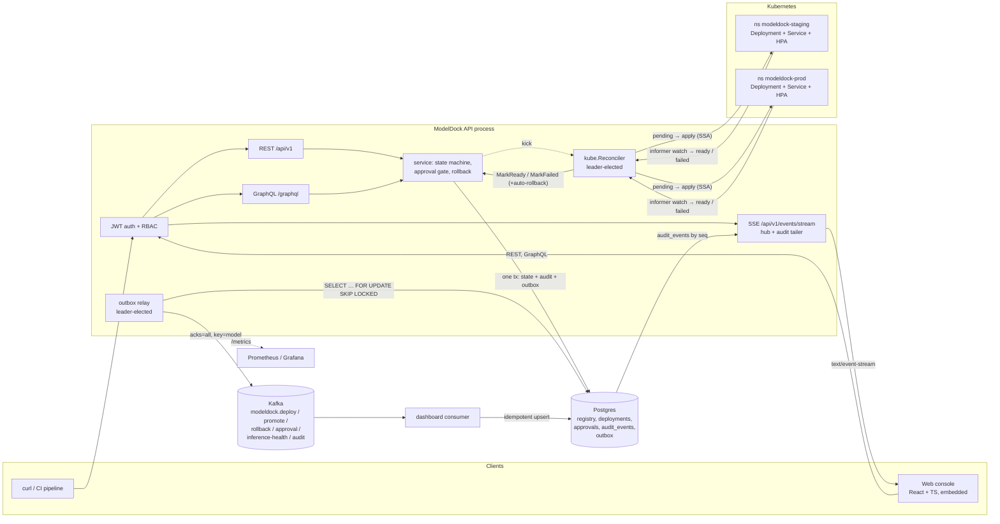
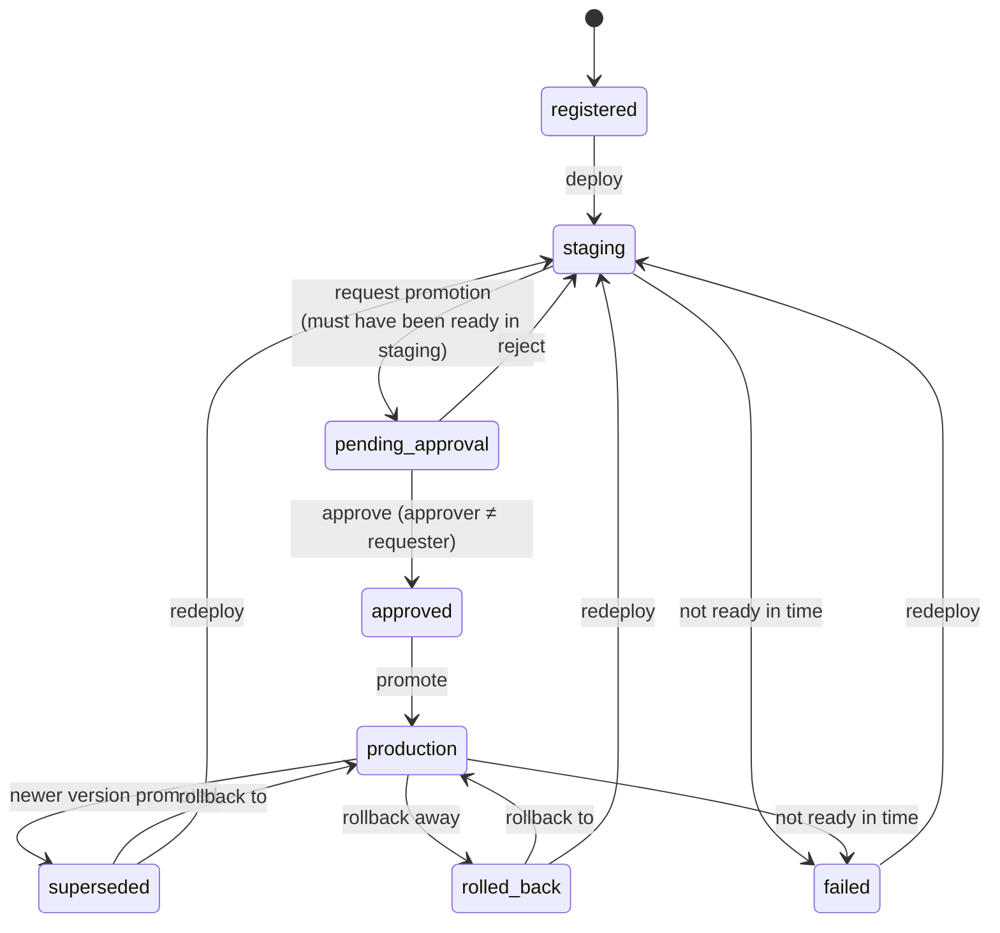
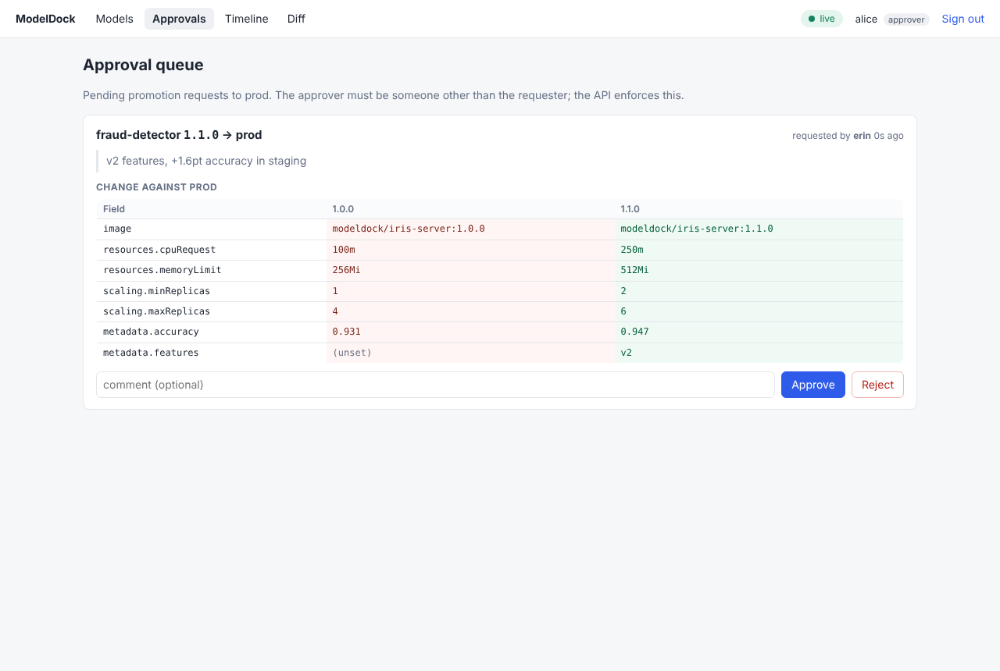
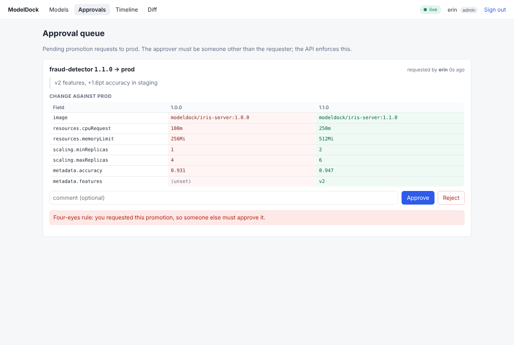
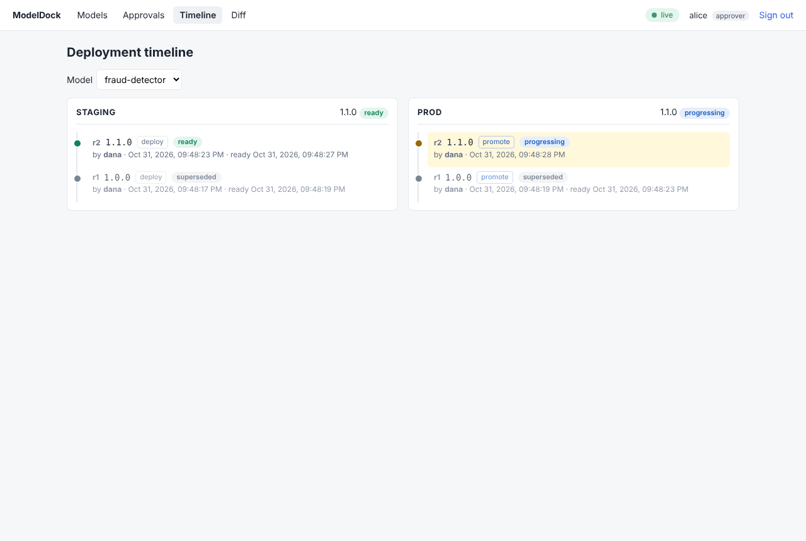
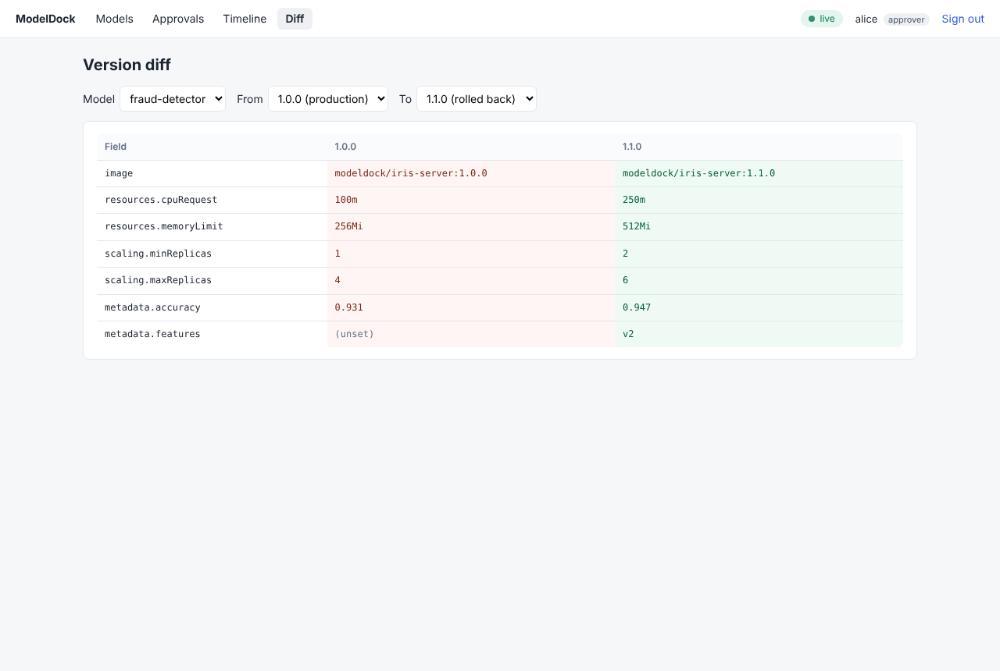
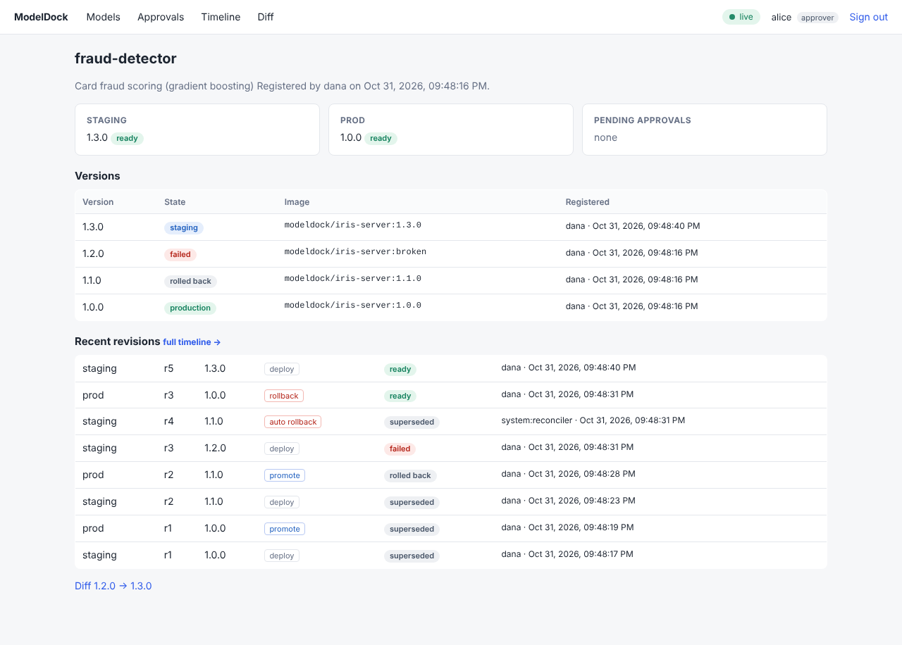
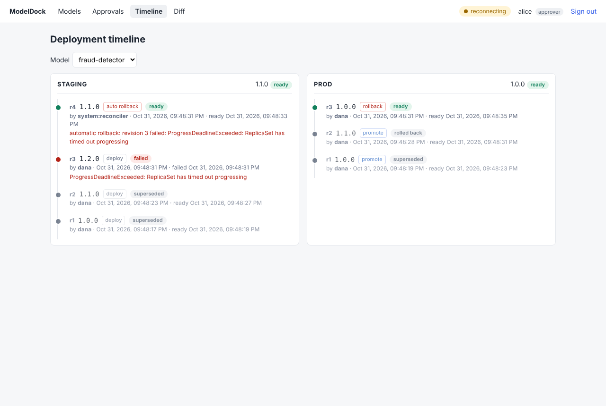
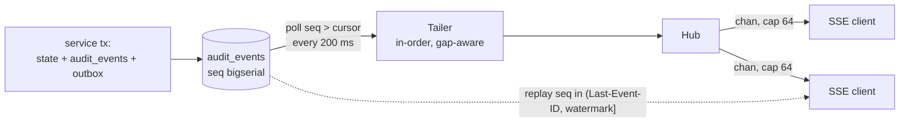

# ModelDock

A model deployment control plane for Kubernetes, written in Go 1.22. You
register model-server images as versions, deploy them to **staging**, get an
**approval** from a different person, **promote** to **prod**, and **roll back**
in one call. Every state change is written to an append-only audit log in
Postgres and published to Kafka through a transactional outbox. A React +
TypeScript console (approval queue, version diff, deployment timeline) shows
rollout status live, streamed to the browser over Server-Sent Events.



> **Verification status, read first.** See [Verification status](#verification-status)
> for exactly what ran where. In short: Postgres, Kafka, the API, the outbox
> under `SIGKILL`, and the Docker images ran for real. Real pods ran on a
> **kind** cluster in CI (`kind-e2e` job, [latest run on PR #1](https://github.com/WenxueWu0216/ModelDock/actions/runs/39693456877)).
> Not yet exercised: HPA scaling, ModelDock itself running in-cluster via
> Helm, and multi-replica failover.

## Architecture



Request path: an API call never touches Kubernetes. It commits a `pending`
deployment row and its audit event in one transaction, then wakes the
reconciler. The reconciler applies the workload, watches it through an
informer, and records `ready` or `failed` (in another single transaction with
its event). If the process dies between those steps, the next leader picks up
the `pending` or `progressing` rows and carries on.

### Version lifecycle (state machine)



The transition table in [`domain/statemachine.go`](domain/statemachine.go) is
the single source of truth. Tests check that only `approved → promote` and
`superseded|rolled_back → rollback` can reach `production`, so neither a
rollback nor a direct deploy can get around the approval gate.

## Repository layout

| Path | What |
|---|---|
| `domain/` | Entities, version state machine, diff, validation (pure, no I/O) |
| `auth/` | JWT (HS256) verification, role claims, RBAC policy, four-eyes rule, middleware |
| `service/` | Use cases: register, deploy, request/approve/reject, promote, rollback, reconciler callbacks |
| `store/` | Postgres via pgx, embedded golang-migrate migrations, outbox claim, audit log, dashboard read model |
| `events/` | Event envelope and topics, outbox relay, Kafka publisher, dashboard consumer |
| `kube/` | `Client` interface, manifest builder, **`Fake`** (tests) and **`ClientGo`** (real) implementations, reconciler |
| `api/` | REST (Go 1.22 `ServeMux` patterns), GraphQL (gqlgen, `api/graph`), the SSE endpoint, CORS, console serving, HTTP metrics |
| `stream/` | SSE fan-out hub (bounded per-client buffers) and the ordered audit-log tailer that feeds it |
| `web/` | React 18 + TypeScript + Vite console; `web/embed.go` embeds `web/dist` with `-tags embedweb` |
| `cmd/modeldock/` | `serve`, `consume`, `migrate`, `token`, `render` |
| `model-server/` | Sample FastAPI + scikit-learn Iris server: `/health`, `/predict`, `/metrics` |
| `deploy/` | Dockerfile, docker-compose (Postgres, Kafka KRaft, API, consumer), Helm chart |
| `observability/` | Grafana dashboard JSON, Prometheus scrape config and alert rules |
| `loadtest/`, `docs/results.md` | vegeta script and the measured results |
| `scripts/` | `demo.sh` (curl + GraphQL walkthrough), `demo-live.sh` (rollout to watch in the console), `console-walkthrough.cjs` (Playwright checks + screenshots), `kind-e2e.sh` (real-cluster test) |

## Quick start

```sh
make setup          # Go modules, staticcheck, kubeconform, model-server venv
make test           # starts Postgres + Kafka via compose, runs every Go test
make compose-up     # Postgres, Kafka, API + web console (:8080, fake kube), dashboard consumer
make demo           # walkthrough below, against the running stack
```

Then open <http://localhost:8080> and paste a token from
`go run ./cmd/modeldock token -sub alice -role approver` (see [Web console](#web-console)).

`make help` lists all targets: `lint`, `manifests`, `model-server-test`,
`web`, `web-test`, `web-dev`, `demo-live`, `walkthrough`, `loadtest`,
`kind-e2e`, `images`, and so on.

To deploy model servers for real, run the API with `-kube real` and a
kubeconfig (`modeldock serve -kube real -kubeconfig ~/.kube/config`), or install
the Helm chart, which uses in-cluster config and a least-privilege service account.

## API examples

Tokens: `modeldock token -sub dana -role deployer` mints a dev JWT signed with
`MODELDOCK_JWT_SECRET`. Roles are `viewer`, `deployer`, `approver`, `admin`.

```sh
API=http://localhost:8080
DEP=$(go run ./cmd/modeldock token -sub dana  -role deployer)
APR=$(go run ./cmd/modeldock token -sub alice -role approver)
h() { echo "Authorization: Bearer $1"; }

# Register a model and a version (image + metadata + resource requests)
curl -s -XPOST $API/api/v1/models -H "$(h $DEP)" -d '{"name":"iris","description":"Iris classifier"}'
curl -s -XPOST $API/api/v1/models/iris/versions -H "$(h $DEP)" -d '{
  "version":"1.0.0", "image":"modeldock/iris-server:1.0.0",
  "metadata":{"framework":"sklearn","accuracy":"0.93"},
  "resources":{"cpuRequest":"100m","memoryRequest":"128Mi","memoryLimit":"256Mi"},
  "scaling":{"minReplicas":2,"maxReplicas":6,"targetCPUPercentage":70}}'

# Deploy to staging (Deployment + Service + HPA in modeldock-staging) -> 202, status "pending"
curl -s -XPOST $API/api/v1/models/iris/versions/1.0.0/deploy -H "$(h $DEP)" -d '{"environment":"staging"}'
curl -s $API/api/v1/deployments/<id> -H "$(h $DEP)"           # pending -> progressing -> ready

# Promotion: request (deployer), approve (a different approver), promote (deployer)
curl -s -XPOST $API/api/v1/models/iris/versions/1.0.0/promotion-requests -H "$(h $DEP)" -d '{"comment":"staging green"}'
curl -s -XPOST $API/api/v1/approvals/<approval-id>/approve -H "$(h $DEP)"   # 403: deployers cannot approve
curl -s -XPOST $API/api/v1/approvals/<approval-id>/approve -H "$(h $APR)" -d '{"comment":"lgtm"}'
curl -s -XPOST $API/api/v1/models/iris/versions/1.0.0/promote -H "$(h $DEP)"

# Rollback in one call: to the previous known-good version, or to a named one
curl -s -XPOST $API/api/v1/models/iris/rollback -H "$(h $DEP)" -d '{"environment":"prod"}'
curl -s -XPOST $API/api/v1/models/iris/rollback -H "$(h $DEP)" -d '{"environment":"prod","toVersion":"1.0.0"}'

# Status, history, diff, audit, dashboard
curl -s $API/api/v1/models/iris/status -H "$(h $DEP)"
curl -s "$API/api/v1/models/iris/deployments?environment=prod" -H "$(h $DEP)"
curl -s "$API/api/v1/models/iris/diff?from=1.0.0&to=1.1.0" -H "$(h $DEP)"
curl -s "$API/api/v1/audit?model=iris&limit=20" -H "$(h $DEP)"
curl -s $API/api/v1/dashboard -H "$(h $DEP)"
```

Errors are JSON `{"error": "...", "code": N}`: 400 invalid input, 401 no or
invalid token, 403 role or four-eyes violation, 404 not found, 409 illegal
state transition or race lost.

### GraphQL

`POST /graphql` (playground at `/playground` when enabled). One request can
fetch everything a dashboard needs:

```graphql
{
  model(name: "iris") {
    versions(limit: 10) { version state image metadata { key value } }
    staging { version status revision }
    prod    { version status revision kind readyAt }
    deployments(environment: "prod", limit: 5) { revision version kind status reason }
  }
  diff(model: "iris", from: "1.0.0", to: "1.1.0") { changes { field from to } }
  approvals(status: "pending") { id modelName version requestedBy }
  dashboard { model lastDeployVersion lastDeployStatus failureRate }
}
```

```graphql
mutation { approve(approvalId: "…", comment: "lgtm") { status decidedBy } }
mutation { rollback(model: "iris", environment: "prod") { revision version kind } }
```

Errors carry `extensions.code`: `UNAUTHENTICATED`, `FORBIDDEN`, `NOT_FOUND`,
`CONFLICT`, `BAD_USER_INPUT`, or `INTERNAL`.

## Web console

React 18 + TypeScript (strict) + Vite, in [`web/`](web). Runtime dependencies
are `react` and `react-dom` only: plain `fetch` for REST and GraphQL, a
30-line hash router, hand-written CSS.

| Page | What | API |
|---|---|---|
| Sign in | Paste a JWT (`modeldock token …`). It is kept in `sessionStorage` for the tab; any 401 signs you out. | – |
| Models | Every model with its current staging/prod version and status | GraphQL, one query (replaces `GET /models` + a status call per model) |
| Model | Versions, current revisions, recent history, pending approvals | GraphQL, one query (replaces four REST calls) |
| Approvals | Pending promotion requests, each with an inline diff against what runs in prod. Approve/reject buttons only for `approver`/`admin`. The four-eyes rule stays in the API; its 403 is shown as a clear message. | REST |
| Timeline | Revisions per model per environment: revision, version, kind (`deploy`/`promote`/`rollback`/`auto_rollback`), status, who, when, failure reason | REST + SSE |
| Diff | Pick two versions, see the field-level diff | REST |

**Live status.** One `EventSource` per session subscribes to
`/api/v1/events/stream`. The timeline folds each event into the history it
already loaded ([`web/src/timeline.ts`](web/src/timeline.ts)): a `pending`
event adds the new revision and marks the previous one superseded or rolled
back; later events flip its badge to `progressing`, `ready` or `failed` in
place, without a refetch. The header shows `live` or `reconnecting`. The
browser resumes with `Last-Event-ID`; if it gives up, the client reopens with
`?lastEventId=`. Events are de-duplicated by `seq`. Every reconnect also
reloads the page's data, so the view cannot stay stale.

| Approval queue with inline diff | Four-eyes rule (403 from the API) |
|---|---|
|  |  |
| **Prod promotion in progress, updated live** | **Version diff** |
|  |  |
| **Model page (one GraphQL query)** | **Reconnecting during an API restart** |
|  |  |

**Serving: embedded in the Go binary.** `make build` runs `npm ci && npm run
build` in `web/` and compiles with `-tags embedweb`. The binary then serves
the console at `/`: hashed assets are cached as immutable, `index.html` is
served for client routes, and `/api`, `/graphql` and `/metrics` keep
precedence. The Docker image does the same in a Node build stage, so `make
compose-up` serves the console on :8080. I chose embedding over a separate
compose service for three reasons: one artifact to deploy, same origin (no
CORS, and the SSE token never crosses origins), and the console version
always matches the API it talks to. Without the tag (`go build ./...`, `go
test ./...`, `make build-go`) the binary serves a short note at `/`, so Go
work never needs Node. `-console=false` turns the route off.

**Development.**

```sh
make run            # API on :8080 (or: make compose-up)
make web-dev        # Vite on :5173 with hot reload; proxies /api and /graphql to :8080
make web-test       # tsc --noEmit + Vitest (jsdom, Testing Library)
```

To call the API cross-origin instead of through the proxy, set
`VITE_API_BASE=http://localhost:8080`. The API allows
`http://localhost:5173` by default (`-cors-origins`).

### Watch a rollout live

```sh
FAKE_READY_POLLS=3 FAKE_FAIL_IMAGE=broken make compose-up   # rollouts take ~6 s; "broken" images fail
make demo-live                                             # prints tokens, then drives the rollout
```

Open <http://localhost:8080>, paste the approver token it prints, and pick
the model it names on the Timeline page. The script deploys 1.0.0 and 1.1.0
to staging, requests and approves promotion, promotes to prod, deploys a
broken 1.2.0 that fails and auto-rolls back, and finally rolls prod back.
Each badge changes as it happens. With `APPROVE=browser` the script waits
for you to approve in the Approvals page. `make walkthrough` runs the same
kind of flow headless with Playwright, asserts each step in the DOM, and
regenerates the screenshots.

## Live event stream (SSE)

`GET /api/v1/events/stream` streams every audit event to the browser as
[Server-Sent Events](https://html.spec.whatwg.org/multipage/server-sent-events.html):
deploy, promote, rollback and approval events, plus every deployment status
change (`pending → progressing → ready | failed`).

```sh
V=$(go run ./cmd/modeldock token -sub vic -role viewer)
curl -N -H "Authorization: Bearer $V" "$API/api/v1/events/stream?model=iris"
curl -N -H "Authorization: Bearer $V" -H "Last-Event-ID: 42" "$API/api/v1/events/stream"   # resume
```

| | |
|---|---|
| Auth | Same JWT and RBAC as the rest of the API; any role (viewer or above). `EventSource` cannot set headers, so this route alone also accepts `?access_token=<jwt>`. A sent `Authorization` header always wins. |
| Filter | `?model=<name>` (404 if the model does not exist) |
| Resume | `Last-Event-ID` header (sent automatically by `EventSource` on reconnect) or `?lastEventId=` |
| Keep-alive | `: ping` comment every 15 s; `retry: 3000` tells the browser to reconnect after 3 s |
| Headers | `Content-Type: text/event-stream`, `Cache-Control: no-cache`, `Connection: keep-alive`, `X-Accel-Buffering: no` |

### Event contract

Each event is one frame:

```
id: 57
event: deploy.ready
data: {"seq":57,"eventId":"…","type":"deploy.ready","actor":"system:reconciler","model":"iris","version":"1.1.0","environment":"prod","deploymentId":"…","revision":3,"kind":"promote","status":"ready","occurredAt":"2026-10-31T21:32:01.82Z","data":{…}}
```

- `id` is the audit log sequence number (`audit_events.seq`). It is globally
  ordered; a client resumes by sending the last id it saw.
- `event` is the event type. The data JSON has these fields:

| `event` / `type` | `status` | `kind` | other fields |
|---|---|---|---|
| `deploy.requested` | `pending` | `deploy` | `revision`, `deploymentId` |
| `promote.started` | `pending` | `promote` | `revision`, `deploymentId` |
| `rollback.started` | `pending` | `rollback` \| `auto_rollback` | `revision`, `deploymentId`, `data.fromVersion`, `data.reason` |
| `deploy.progressing` | `progressing` | kind of the revision | `revision`, `deploymentId` |
| `deploy.ready` | `ready` | kind of the revision | `revision`, `deploymentId` |
| `deploy.failed` | `failed` | kind of the revision | `revision`, `deploymentId`, `data.reason` |
| `approval.requested` / `approval.approved` / `approval.rejected` | | | `approvalId`, `data.comment`, `data.requestedBy` |
| `registry.model_registered` / `registry.version_registered` | | | |
| `inference_health.changed` | | | `data.status` (`healthy` \| `degraded` \| `unavailable`) |
| `stream.reset` (control) | | | the client is too far behind (> 10 000 events) and should reload state |

Common fields on every event: `seq`, `eventId`, `type`, `actor` (JWT
subject, or `system:reconciler`), `model`, `version`, `environment`,
`occurredAt`, and `data` (the raw audit payload). Starting a new revision
implicitly marks the previous revision of that model/environment
`superseded` (promote/deploy) or `rolled_back` (rollback); there is no
separate event for that.

### Design



**Source: tail the audit log, not Kafka and not in-process callbacks.**
Every status change already writes an `audit_events` row in the same
transaction as the change, so the audit log is the one place that is both
complete and ordered.
- An in-process broker fed by the service would miss events from other
  replicas, because only the leader runs the reconciler (and so produces
  every `progressing`/`ready`/`failed`).
- A Kafka consumer group per replica would work across replicas, but adds
  the relay's polling lag on top. It does not exist in `-events log` mode.
  Replay would still have to read Postgres, giving two sources to reconcile
  at the hand-over.
- Tailing the table gives live delivery and `Last-Event-ID` replay from the
  same rows with the same ids. Every API replica runs its own tailer; no
  leader is needed. The cost is one indexed query per poll interval per
  replica (`-stream-poll-interval`, default 200 ms), which also bounds the
  added latency.

**Ordering and gaps.** `seq` is assigned at INSERT, so transactions can
commit out of order: seq 51 may be visible while 50 is still in flight. The
tailer keeps a cursor below which everything is resolved. It holds events
back behind a missing seq until the gap fills, or for at most 3 s. Sequences
are not transactional, so a rolled-back transaction leaves a permanent gap
(counted in `modeldock_sse_tailer_gaps_skipped_total`). Events reach clients
in strict `seq` order, which is what makes "last id seen" a correct resume
point. One edge case remains: a transaction that commits more than 3 s after
taking its seq is skipped by live clients. It is still in the audit log and
shows up on the next page load.

**Fan-out and backpressure.** The hub gives each connection a buffered
channel (64 events). `Publish` never blocks. If a client's buffer is full,
the hub drops that client (`modeldock_sse_slow_client_drops_total`), and its
handler flushes what is buffered and ends the response. The browser then
reconnects with `Last-Event-ID` and replays the rest from the database. A
slow client costs itself a reconnect, never the hub or other clients a
stall. Each write also has a 10 s deadline, so a stalled TCP peer cannot pin
a handler goroutine. On client disconnect the request context is cancelled
and the subscription is removed (`context.AfterFunc`). On server shutdown
the hub closes every stream so `http.Server.Shutdown` does not wait on them.

**Resume without gaps or duplicates.** The handler subscribes first and gets
the hub's watermark: the highest seq already handed to subscribers. It then
replays `Last-Event-ID < seq <= watermark` from `audit_events` (filtered by
model, 500 per page) and switches to the live channel, which carries exactly
the events above the watermark.

**Metrics:** `modeldock_sse_connections` (gauge),
`modeldock_sse_events_sent_total`, `modeldock_sse_slow_client_drops_total`,
`modeldock_sse_tailer_gaps_skipped_total`.

**CORS.** `-cors-origins` / `MODELDOCK_CORS_ORIGINS` (comma-separated,
default `http://localhost:5173` for the Vite dev server, `*` for any, empty
to disable). Preflights are answered before auth. Credentials are never
allowed because auth uses bearer tokens, not cookies.

## RBAC

| | viewer | deployer | approver | admin |
|---|:-:|:-:|:-:|:-:|
| read (models, history, audit, dashboard) | ✓ | ✓ | ✓ | ✓ |
| register models/versions | | ✓ | | ✓ |
| deploy staging, request promotion, promote approved, rollback | | ✓ | | ✓ |
| approve / reject promotions | | | ✓ | ✓ |

The roles are intentionally **not a hierarchy**: approvers cannot deploy and
deployers cannot approve. In addition, **nobody can approve a request they
made**, admins included. This is enforced in `auth.CanDecide` and again by a
Postgres `CHECK (decided_by <> requested_by)` constraint.

## Design decisions

**Why the outbox pattern.** A deployment record and its audit event must
never diverge. A plain "commit, then publish" approach loses the event if the
process dies in between; "publish, then commit" announces changes that may
then roll back. With the outbox, the event row is written in the same
transaction as the state change (`Tx.AppendEvent`), and a relay publishes
committed rows afterwards. `events/outbox_crash_test.go` `SIGKILL`s a child
process at three points (mid-transaction, after commit before publish, and
after broker ack before the row is marked published) and checks that no event
is lost and that no event exists without its state. Delivery is at least once;
the dashboard consumer dedupes by event ID in the same transaction as its
projection, so its effects are exactly once.

**Why an approval gate, and why in the state machine.** Production changes
need a second pair of eyes, and an auditor needs to see who approved what. The
gate is a state (`approved`), not a flag that handlers check, so every path to
`production` (promote, rollback, auto-rollback) goes through the transition
table, and tests enumerate that table. Rollback skips re-approval only for
versions that were already live in prod. That keeps "rollback in one call"
fast during an incident without opening a bypass.

**Why both REST and GraphQL.** REST suits automation: CI pipelines and
`curl`, cacheable GETs, and clear status codes. GraphQL suits dashboards that
want a model, its versions, per-environment status, and recent history in one
round trip. Both are thin adapters over the same `service` methods, so
authorization and state rules cannot drift between them. The cost is two
surfaces to document, and GraphQL needs query cost limits
(`FixedComplexityLimit(500)`, bounded list arguments). The load test found an
unbounded `versions` list, now fixed.

**Why the API never calls Kubernetes.** The database holds the desired state
and the reconciler converges the cluster toward it. Requests stay fast and
independent of API-server latency, a crash cannot leave a half-applied
deployment untracked, and re-applying is idempotent (server-side apply, field
manager `modeldock`).

**Other trade-offs**
- *Polling + `SKIP LOCKED` vs. CDC (Debezium) or `LISTEN/NOTIFY`.* Polling is
  simple and has no extra infrastructure; it costs about 130 ms p50 of
  commit-to-Kafka lag at a 500 ms interval (measured).
- *Single leader via Postgres advisory locks* for the relay and reconciler.
  This keeps per-model event order, and API replicas scale horizontally. The
  leader's locks use their own connections, outside the request pool (a bug
  the load test found).
- *One Kubernetes Deployment per model per environment*, updated with
  rolling updates (`maxUnavailable: 0`). This is not canary or blue-green.
- *Identity is delegated*: ModelDock stores the JWT subject on every action
  but keeps no users table. HS256 is used for simplicity; production would use
  RS256/JWKS from an IdP (only the key function changes).
- *Text + CHECK columns instead of Postgres enums*, so adding a state is a
  cheap, transactional migration.

## Observability

- `/metrics` exposes:
  - `modeldock_http_request_duration_seconds{route,method,code}`
  - `modeldock_deploy_duration_seconds{environment,kind,outcome}`
  - `modeldock_promotions_total`
  - `modeldock_rollbacks_total{trigger}`
  - `modeldock_approval_decisions_total`
  - the outbox metrics: backlog, oldest age, published, errors
  - `modeldock_inference_health_changes_total`
  - the event stream metrics: `modeldock_sse_connections`,
    `modeldock_sse_events_sent_total`, `modeldock_sse_slow_client_drops_total`,
    `modeldock_sse_tailer_gaps_skipped_total`
- Model servers expose `model_predictions_total`, `model_prediction_latency_seconds`
  and `model_info`. ModelDock adds `prometheus.io/*` pod annotations.
- [`observability/grafana/modeldock-dashboard.json`](observability/grafana/modeldock-dashboard.json)
  has 20 panels. Every query was evaluated against a live Prometheus scraping
  the compose stack. The model-server panels had no data there, because no
  real pods ran.
- [`observability/prometheus/alerts.yml`](observability/prometheus/alerts.yml)
  holds alerts for a stalled outbox, rollout failures, and API 5xx (checked
  with `promtool`).

## Load test

Measured with vegeta on a single 4-vCPU VM (load generator, API, Postgres,
and Kafka all on one host; fake kube). Full details and caveats are in
[`docs/results.md`](docs/results.md).

| Scenario | Rate | p50 | p99 |
|---|---:|---:|---:|
| REST status | 300/s | 1.90 ms | 5.08 ms |
| REST history | 300/s | 1.82 ms | 5.38 ms |
| GraphQL composite query | 300/s | 2.63 ms | 17.1 ms |
| Register version (tx + audit + outbox) | 100/s | 3.88 ms | 10.6 ms |

The first run showed GraphQL p50 at **599 ms**. That run exposed the pool
exhaustion and unbounded-list bugs described in `docs/results.md`; both are fixed.

## Verification status

**Verified in the development sandbox**

| What | How |
|---|---|
| State machine, RBAC matrix, four-eyes rule, JWT validation (expired, wrong alg/key/iss/aud, `none`), middleware | unit tests |
| Store against **real Postgres 16**: migrations, revision numbering, CAS updates, append-only audit trigger (UPDATE/DELETE/TRUNCATE rejected), self-approval DB constraint, leader lock | `store/` tests |
| Full lifecycle, auto-rollback, rollback guards, concurrent approvers (exactly 1 wins), concurrent deploys (distinct revisions) | `service/` tests (real Postgres + fake kube) |
| Outbox crash consistency with real `SIGKILL` at 3 points | `events/outbox_crash_test.go` |
| Relay → **real Kafka 3.8** → consumer → dashboard; per-model ordering; dedup of forced redelivery | `TestKafkaEndToEnd` |
| REST + GraphQL over HTTP with real JWTs, error mapping, metrics exposure | `api/` tests |
| `go test -race ./...`, `go vet`, staticcheck, golangci-lint: clean | local |
| Builds on **Go 1.22** (image built with the `golang:1.22` builder) | `deploy/Dockerfile` |
| docker-compose stack (Postgres, Kafka, API, consumer) running `scripts/demo.sh` end to end | local |
| Model-server image: trains at build, runs read-only / non-root / no caps, `/predict` correct | `docker run` + pytest |
| Rendered manifests and Helm chart pass `kubeconform -strict` (k8s 1.30) and **server-side dry-run** on k3s 1.31 | `make manifests` |
| `kube.ClientGo` against a **real k3s v1.31 API server**: SSA of Deployment/Service/HPA, idempotent re-apply, informer-observed status, revision tracking | `TestClientGoAgainstRealCluster` |
| `modeldock serve -kube real` on k3s as the **chart's least-privilege service account**; the reconciler failed a never-ready rollout at the deadline ("not ready within 45s (updated=1 available=0 desired=1)") | manual run |
| Helm install on k3s; `kubectl auth can-i` confirms the SA can manage workloads only in the target namespaces (no pods, secrets, or other namespaces) | manual run |

**Verified on a real cluster (kind, GitHub Actions `kind-e2e` job)**

`scripts/kind-e2e.sh`, [CI run 39693456877](https://github.com/WenxueWu0216/ModelDock/actions/runs/39693456877):

- The `kube.ClientGo` test saw a real rollout complete (`Updated:1 Ready:1 Available:1`).
- ModelDock ran with `-kube real` and `-events kafka` and drove two versions
  through staging, approval, and prod, then rolled prod back. Afterwards prod's
  `/predict` returned `1.0.0 setosa` from a running pod.
- An unpullable image was marked `failed` through Kubernetes'
  `ProgressDeadlineExceeded` (the deadline is 90% of the 90 s rollout timeout),
  and staging auto-rolled back to 1.1.0, which reached `ready`. An earlier run
  of this job caught a bug on exactly this path: the rollback was failed
  instantly because of the previous rollout's stale condition. It is fixed in
  `StatusFromDeployment`, with a regression test.

The development sandbox itself could not start pods (its VM rejects the
negative `oom_score_adj` that kubelet sets on pod sandboxes). Only the
k3s-based checks above ran there.

**Web console and event stream (verified in the development sandbox)**

| What | How |
|---|---|
| Hub: fan-out, model filter, slow-client drop without blocking `Publish`, unsubscribe on context cancel, close on shutdown, concurrent subscribe/publish | `stream/hub_test.go`, `go test -race` |
| Tailer: starts at the end of the log, publishes in `seq` order, holds back behind an uncommitted gap until it fills, skips a permanent gap after the timeout | `stream/tailer_test.go` |
| SSE over HTTP against real Postgres: headers, live `pending → progressing → ready` for a real rollout through the reconciler, approval events, `?model=` filter, `Last-Event-ID` replay then live with no gap or duplicate, `?lastEventId=`, heartbeat, metrics, 401/404/400 cases, CORS preflight | `api/stream_test.go` (httptest) |
| Console handler: SPA fallback, asset caching, API precedence, placeholder without the embed | `api/console_test.go` |
| `go vet`, staticcheck 2024.1.1 and `go test -race -count=1 ./...` with Postgres 16 and Kafka 3.8 from compose, on Go 1.22.12 | local |
| Console: `tsc --noEmit`, `vite build`, 12 Vitest + Testing Library tests (approval queue: list + inline diff, role-gated buttons, four-eyes 403 message, approve with comment, live refetch; timeline: render, in-place live updates without refetch, de-dup, reconnect with `lastEventId` and reload; `applyEvent` unit tests) | `make web-test` |
| `curl -N` against `modeldock serve`: live frames, `Last-Event-ID: 3` replays seq 4–5, `/metrics` exposes the SSE metrics | manual run |
| Compose stack with the console embedded in the image: `scripts/demo.sh` and `scripts/demo-live.sh` end to end | local (see note) |
| Playwright (headless Chromium) against the compose stack, 13 DOM-level checks: live progressing/ready badges with no history refetch, approval queue + inline diff, four-eyes 403 for an admin who requested, approve from the queue, failure + auto-rollback shown live, `reconnecting → live` across `docker compose restart api` with updates continuing after it, diff page, GraphQL model page | `scripts/console-walkthrough.cjs` |

Note on the image: Docker Hub rate-limited the sandbox (HTTP 429), and its
TLS-intercepting egress proxy is not trusted inside `docker build`. So I
built the image from a copy of `deploy/Dockerfile` that only adds the
sandbox proxy's CA certificate to the two build stages. The committed
Dockerfile is otherwise what ran. The `web` CI job is new and has not run
yet; the workflow runs it on pull requests.

**Measured: event latency to the browser.** `scripts/console-walkthrough.cjs`
keeps an `EventSource` open in a separate tab and records `Date.now()` on
receipt minus the event's `occurredAt`. `occurredAt` is set by the API
process when it creates the event, just before the transaction commits, so
this is an upper bound on commit-to-browser time. Browser and API container
ran on the same host and share a clock. Setup: compose stack, default 200 ms
tailer poll interval, one viewer, the walkthrough's deploy/promote/rollback/
approval events (registry events excluded). Events replayed after the API
restart are excluded, because they include downtime.

| Run | Events | min | p50 | p95 | max |
|---|---:|---:|---:|---:|---:|
| 1 | 25 | 70 ms | 152 ms | 202 ms | 204 ms |
| 2 (fresh volumes) | 25 | 19 ms | 112 ms | 199 ms | 201 ms |

The spread matches the poll interval: an event waits between 0 and 200 ms
for the next poll. Lowering `-stream-poll-interval` trades latency for
queries per second. Not measured: many concurrent SSE clients,
multi-replica fan-out, and behaviour behind a buffering reverse proxy
(`X-Accel-Buffering: no` is set for nginx but untested).

**Not verified**

- HPA scaling behaviour (needs metrics-server), PodDisruptionBudget, and the
  ServiceMonitor (needs the Prometheus Operator).
- Helm-deployed ModelDock pods running in-cluster (images were not pushed
  anywhere).
- Multi-replica API leader failover under load (the lock itself is tested).
- Multi-broker Kafka and real `acks=all` replication.

### Verify on a real cluster

```sh
# kind (local): creates the cluster, loads the model image, runs Postgres+Kafka
# in compose and ModelDock on the host with -kube real, then checks pods,
# /predict after rollback, and failure + auto-rollback.
make kind-e2e

# or step by step against any cluster in your kubeconfig:
make deps-up build
docker build -t modeldock/iris-server:1.0.0 model-server            # push to your registry if not kind
MODELDOCK_TEST_KUBECONFIG=$HOME/.kube/config MODELDOCK_TEST_EXPECT_READY=1 \
  MODELDOCK_TEST_IMAGE=<registry>/iris-server:1.0.0 go test -run RealCluster -v ./kube/
./bin/modeldock serve -kube real -events kafka -kafka-brokers localhost:29092 -auto-rollback \
  -database-url "$MODELDOCK_TEST_DATABASE_URL" &
WAIT_SECS=180 ./scripts/demo.sh            # change the image refs in demo.sh to your registry
kubectl -n modeldock-prod get deploy,svc,hpa,pods
```

## Limitations

- One rollout strategy (rolling update). No canary, traffic splitting, or
  shadow deployments.
- Model servers must expose `/health` on a named `http` port. Probes are not
  configurable per version.
- Readiness means "pods available". It does not check model quality.
  Inference-health events come from replica availability, not from probing
  `/predict` or reading error-rate metrics.
- Outbox polling adds up to one interval (500 ms) of lag. Kafka downtime
  grows the backlog (alerted on) but never blocks the API.
- The dashboard read model is eventually consistent and depends on Kafka.
- HS256 shared-secret JWTs; no token revocation. The console has no login
  flow of its own: you paste a token. The SSE endpoint accepts the token in
  the URL (`EventSource` cannot send headers), where proxies may log it.
- Live delivery adds up to one tailer poll interval (200 ms) of latency, and
  each API replica runs one audit-log query per interval. A transaction that
  commits more than 3 s after taking its audit sequence number is skipped by
  open streams (it is still in the audit log and appears on reload).
- The console is desktop-first and has no write actions besides
  approve/reject. Deploy, promote and rollback stay in the API, CLI and CI.
- Rollback to a version that has since been redeployed to staging is refused
  (its state is `staging`, not `superseded`/`rolled_back`). Promote it again instead.
- The `environments` table is seeded with staging/prod; there is no API to add more.
